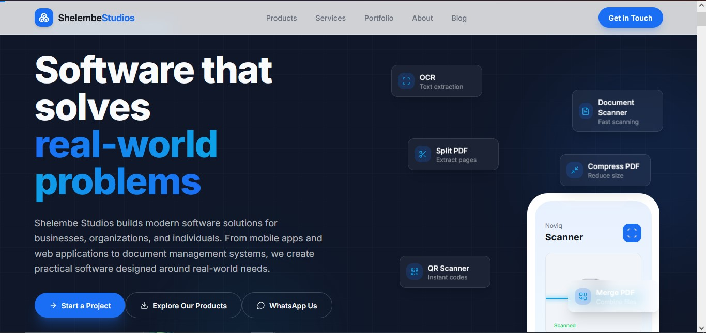
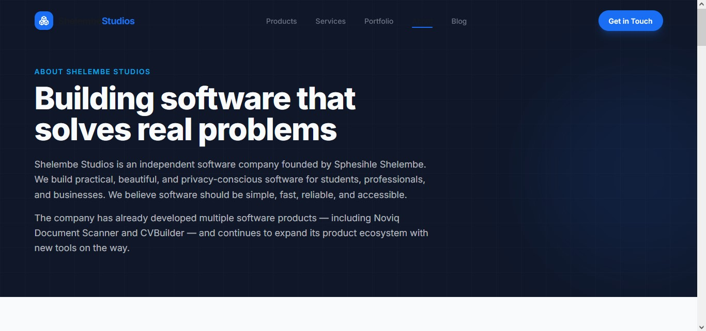
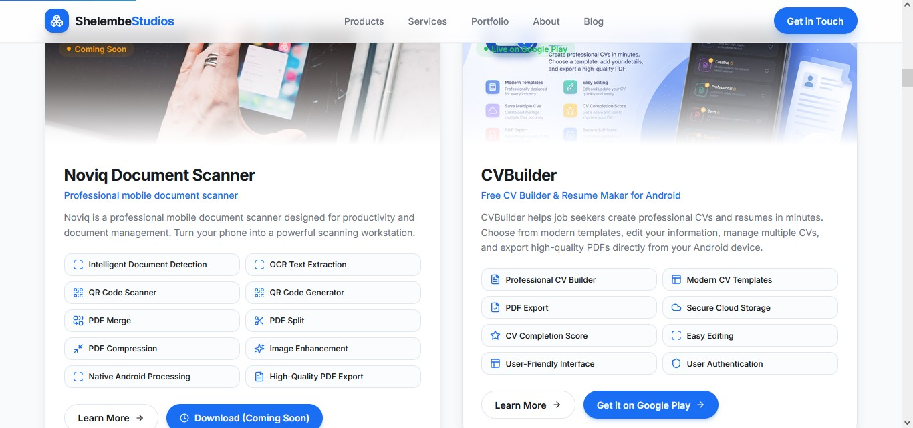
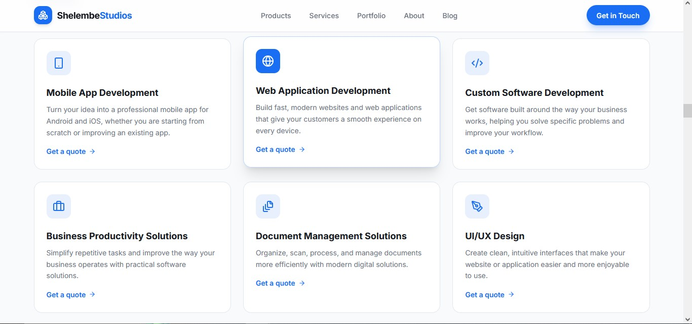
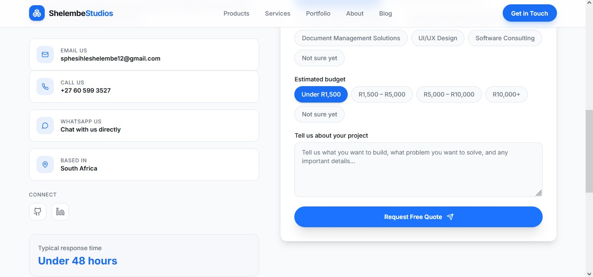

# Shelembe Studios

### Building Software That Solves Real Problems

[](https://shelembe-studios-website.vercel.app/)


## 🌐 Overview

Shelembe Studios is a software development studio founded by Sphesihle Shelembe. It focuses on building modern, practical software solutions for businesses, organisations and individuals.

The website serves as the studio's digital presence, showcasing its software products, development services, technologies and portfolio.

**Live Website:** https://shelembe-studios-website.vercel.app/

## ✨ Features

- **Modern Landing Page** – Introduces the studio and its software development approach.
- **Product Showcase** – Highlights Noviq and CVBuilder.
- **Services Section** – Presents mobile app development, web applications, custom software development and other services.
- **Portfolio** – Showcases projects, their features, technologies and development processes.
- **Technology Showcase** – Displays the technologies used across the studio's projects.
- **Founder Profile** – Introduces the founder and development background.
- **Contact Section** – Provides ways for potential clients to get in touch.
- **Responsive Design** – Designed to provide an accessible experience across devices.

## 🛠️ Built With

### Frontend
- Next.js
- React
- TypeScript
- Tailwind CSS

### Development Tools
- Git
- GitHub
- Visual Studio Code

### Deployment
- Vercel

## 📸 Screenshots

<p align="center">
  
  
  
  
  
</p>

## 🚀 Getting Started

### Prerequisites

- Node.js
- npm
- Git

### Clone the repository

```bash
git clone https://github.com/sphesihleshelembe/shelembe-studios-website.git
cd shelembe-studios-website
```

### Install dependencies

```bash
npm install
```

### Start the development server

```bash
npm run dev
```

Open http://localhost:3000 in your browser.

*Note: These commands assume the project uses the standard Next.js npm scripts. Check `package.json` if your scripts differ.*

## 📂 Main Technologies

| Technology | Purpose |
|---|---|
| Next.js | Web application framework |
| React | User interface development |
| TypeScript | Type-safe development |
| Tailwind CSS | Interface styling |
| Vercel | Website deployment |
| Git & GitHub | Version control and source management |

## 🚀 Featured Projects

### Noviq
An Android document scanner and PDF toolkit featuring document detection, OCR, QR tools and PDF utilities.

### CVBuilder
An Android CV creation application that helps users create professional CVs, manage their information and export documents as PDFs.

## 🎯 Services Showcased

- Mobile application development
- Web application development
- Custom software development
- Business productivity solutions
- Document management solutions
- UI/UX design
- Software consulting

## 👨‍💻 Developer

**Sphesihle Shelembe**

Founder & Lead Software Developer at Shelembe Studios.

## 📄 License

Copyright © 2026 Shelembe Studios.

All Rights Reserved.

This project and its source code are proprietary to Shelembe Studios. No permission is granted to copy, modify, distribute or use this software or its source code without prior written permission from the copyright owner.
